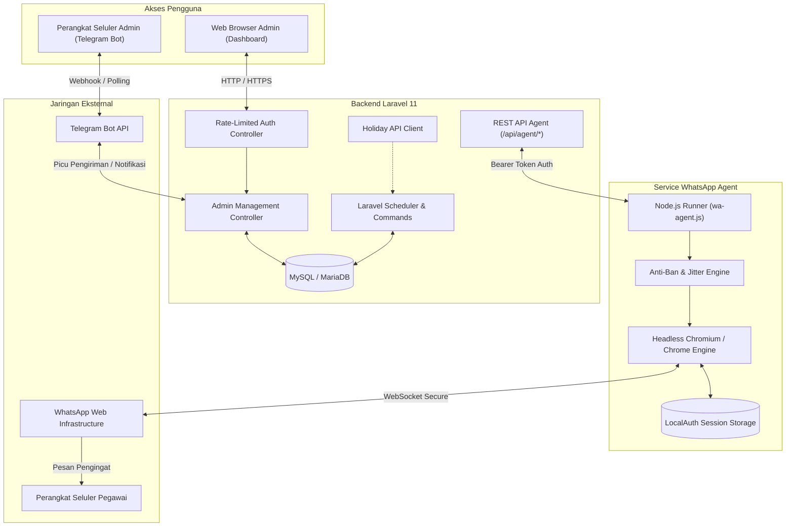

# BPS Smart Attendance Reminder v3.0

Sistem Otomasi Pengingat Absensi Pegawai Terintegrasi WhatsApp Web Headless dan Telegram Remote Control.

[](https://laravel.com)
[](https://nodejs.org)
[](https://tailwindcss.com)
[](LICENSE)

---

## Daftar Isi

- [Deskripsi Sistem](#deskripsi-sistem)
- [Fitur Utama](#fitur-utama)
- [Arsitektur Sistem](#arsitektur-sistem)
- [Mekanisme Anti-Ban dan Keamanan](#mekanisme-anti-ban-dan-keamanan)
- [Prasyarat Sistem](#prasyarat-sistem)
- [Panduan Instalasi](#panduan-instalasi)
- [Petunjuk Pengoperasian](#petunjuk-pengoperasian)
- [Struktur Direktori](#struktur-direktori)
- [Pengujian Unit dan Fitur](#pengujian-unit-dan-fitur)
- [Tech Stack](#tech-stack)
- [Lisensi](#lisensi)

---

## Deskripsi Sistem

BPS Smart Attendance Reminder v3.0 adalah aplikasi berbasis web dan service background yang dirancang untuk mengotomasi pengingat kehadiran dan kepulangan pegawai Badan Pusat Statistik (BPS). Sistem ini mengintegrasikan server backend Laravel 11 dengan WhatsApp Web Headless Agent berbasis Puppeteer dan remote control interaktif melalui Bot Telegram Admin.

Sistem bekerja secara mandiri tanpa memerlukan biaya langganan API gateway berbayar pihak ketiga dan berjalan 100% di latar belakang (*headless*) tanpa mengganggu aktivitas tampilan layar kerja komputer kantor.

---

## Fitur Utama

### 1. WhatsApp Web Background Agent v3.0
- Berjalan penuh dalam mode headless tanpa membuka jendela antarmuka browser.
- Mendukung browser bawaan Google Chrome maupun Microsoft Edge secara otomatis.
- Penyimpanan sesi persisten (*Persistent LocalAuth Session*) sehingga pemindaian QR code hanya dilakukan satu kali saat instalasi awal.
- Penanganan auto-reconnect dan recovery state secara otomatis saat koneksi jaringan mengalami gangguan.

### 2. Perlindungan Anti-Ban Komprehensif
- Human-Like Jitter Delay: Jeda dinamis antara 20 hingga 40 detik antar pesan untuk mensimulasikan perilaku pengetikan manual manusia.
- Batch Cooldown: Periode istirahat terjadwal selama 60 hingga 120 detik setiap menyelesaikan pengiriman 3 pesan secara berurutan.
- Daily Message Throttling: Pembatasan kuota pengiriman harian untuk mencegah pemblokiran nomor oleh sistem WhatsApp.
- Business Hours Guard: Validasi jendela waktu operasional jam kerja kantor, dengan pengecualian otomatis untuk pesan berkategori manual dan broadcast langsung.

### 3. Telegram Admin Bot Interaktif
- Kendali jarak jauh penuh untuk memicu pengiriman pesan masuk dan pulang langsung dari perangkat seluler admin.
- Pemilihan pegawai secara dinamis melalui inline keyboard di Telegram.
- Pengiriman notifikasi alert seketika kepada admin apabila koneksi WhatsApp terputus atau terjadi kegagalan transmisi.
- Rekapitulasi laporan realtime hasil pengiriman pesan.

### 4. Sinkronisasi Hari Libur Nasional Otomatis
- Terintegrasi langsung dengan API resmi Hari Libur Nasional dan Cuti Bersama Indonesia.
- Penangguhan otomatis jadwal pengingat pada hari libur resmi dan akhir pekan tanpa memerlukan intervensi manual.
- Dukungan konfigurasi jam kerja fleksibel (Senin-Kamis, Jumat, dan jadwal khusus Ramadan).

### 5. Web Dashboard Manajemen Modern
- Antarmuka berbasis Laravel 11, Tailwind CSS v4, dan SweetAlert2.
- Manajemen data pegawai lengkap dengan validasi nomor telepon unik serta fitur Import dan Export data format CSV.
- Pemantauan live outbox dan sinkronisasi status pengiriman riil dari database.
- Proteksi brute-force login menggunakan rate limiter (5 percobaan per menit).
- Fitur pembaruan kata sandi admin langsung dari antarmuka dashboard.

---

## Arsitektur Sistem



---

## Mekanisme Anti-Ban dan Keamanan

1. **Randomized Delivery Jitter**: Parameter jeda acak dikonfigurasi melalui variabel lingkungan `WA_DELAY_MIN` dan `WA_DELAY_MAX`.
2. **Consecutive Failure Auto-Pause**: Sistem akan menghentikan sementara pengiriman selama 5 menit jika terjadi 3 kegagalan beruntun untuk memverifikasi kesehatan koneksi.
3. **Phone Number Sanitization**: Setiap nomor telepon dinormalisasi ke format internasional standar (awalan 62) dan divalidasi keunikannya di tingkat basis data.
4. **Token-Based Internal API Authentication**: Komunikasi antara Node.js agent dan backend Laravel diamankan menggunakan Bearer token pada header otorisasi.
5. **Rate Limiting**: Endpoint autentikasi login dashboard dilindungi dengan limit maksimal 5 request per 60 detik per alamat IP.

---

## Prasyarat Sistem

- **Sistem Operasi**: Windows 10/11, Windows Server, atau Linux (Ubuntu 20.04/22.04 LTS).
- **PHP**: Versi 8.2 atau lebih baru (ekstensi: pdo, pdo_mysql, mbstring, openssl, curl, gd).
- **Node.js**: Versi 18 LTS atau 20+ LTS.
- **Database**: MySQL 8.0+ atau MariaDB 10.5+.
- **Browser**: Google Chrome atau Microsoft Edge terinstal pada sistem host.
- **Composer**: Versi 2.x.

---

## Panduan Instalasi

### 1. Kloning Repositori
```bash
git clone https://github.com/faizarfi/pengingat-absen.git
cd pengingat-absen
```

### 2. Konfigurasi Lingkungan
Salin file konfigurasi contoh dan sesuaikan parameter koneksi:
```bash
copy .env.example .env
```

Pastikan pengaturan berikut telah diisi pada file `.env`:
```env
APP_NAME="Pengingat Absensi BPS"
APP_ENV=local
APP_KEY=
APP_DEBUG=true
APP_URL=http://localhost:8000

DB_CONNECTION=mysql
DB_HOST=127.0.0.1
DB_PORT=3306
DB_DATABASE=pengingat_absen
DB_USERNAME=root
DB_PASSWORD=

TELEGRAM_BOT_TOKEN=
TELEGRAM_ADMIN_CHAT_ID=
WA_AGENT_TOKEN=change-this-token-to-something-secure
```

### 3. Instalasi Dependensi Backend
```bash
composer install
php artisan key:generate
php artisan migrate --seed
php artisan holidays:sync
```

### 4. Instalasi Dependensi Frontend
```bash
npm install
npm run build
```

### 5. Instalasi Dependensi WhatsApp Agent
```bash
cd wa-desktop-agent
npm install
cd ..
```

---

## Petunjuk Pengoperasian

### Menjalankan Melalui Launcher Terpadu (Windows)

Jalankan skrip menu interaktif berikut:
```cmd
START.bat
```

Tersedia opsi menu sebagai berikut:
- **Menu [1]**: Menjalankan seluruh layanan lokal (Laravel Server, WA Agent, Telegram Bot, dan Scheduler).
- **Menu [2]**: Menjalankan seluruh layanan dengan eksposur HTTPS publik melalui Cloudflare Tunnel.
- **Menu [3]**: Menjalankan hanya WA Desktop Agent.
- **Menu [4]**: Menjalankan hanya Telegram Bot listener.
- **Menu [5]**: Membuka dashboard administrator pada browser default.

Alternatif langsung tanpa menu:
```cmd
START-ALL.bat
```

### Menjalankan Secara Manual Per Komponen

1. **Server Aplikasi Laravel**:
   ```bash
   php artisan serve --port=8000
   ```

2. **WhatsApp Web Background Agent**:
   ```bash
   cd wa-desktop-agent
   node wa-agent.js
   ```

3. **Telegram Bot Polling**:
   ```bash
   php artisan telegram:poll
   ```

4. **Laravel Task Scheduler**:
   ```bash
   php artisan schedule:work
   ```

### Autentikasi Awal WhatsApp
1. Jalankan komponen WhatsApp Agent.
2. Pindai kode QR ASCII yang ditampilkan pada jendela konsol menggunakan aplikasi WhatsApp ponsel melalui menu **Perangkat Tertaut (Linked Devices) > Tautkan Perangkat**.
3. Setelah status menampilkan `Autentikasi berhasil`, sesi tersimpan secara lokal dan agen siap memproses antrean pesan.

---

## Struktur Direktori

```text
pengingat-absen/
├── app/
│   ├── Console/Commands/       # Perintah otomatis dan scheduler pengingat
│   ├── Http/Controllers/       # Controller web, autentikasi, dan API internal
│   ├── Models/                 # Model data Eloquent (Employee, Outbox, Schedule, dll.)
│   └── Services/               # Logika bisnis Telegram dan WhatsApp helper
├── config/                     # Konfigurasi aplikasi dan paket eksternal
├── database/
│   ├── migrations/             # Skema tabel database
│   └── seeders/                # Data inisialisasi awal
├── docs/                       # Panduan teknis tambahan dan template berkas
├── resources/
│   ├── css/                    # Pengaturan Tailwind CSS
│   └── views/                  # Blade template dashboard administrator
├── routes/                     # Definisi rute web dan API
├── scripts/                    # Skrip batch peluncuran otomasi Windows
├── tests/                      # Rangkaian pengujian unit dan fitur
└── wa-desktop-agent/           # Service Node.js headless WhatsApp agent
    ├── wa-agent.js             # Entrypoint utama WhatsApp runner
    └── package.json            # Dependensi agen Node.js
```

---

## Pengujian Unit dan Fitur

Aplikasi dilengkapi dengan rangkaian automated test suite menggunakan PHPUnit. Untuk menjalankan seluruh pengujian:

```bash
php artisan test
```

Cakupan pengujian mencakup:
- Keamanan autentikasi dan rate limiting pada endpoint login.
- Integritas pembaruan kata sandi administrator.
- Validasi pencegahan duplikasi data pegawai berdasarkan nomor telepon.
- Sinkronisasi status keterkiriman outbox secara presisi pada dashboard.
- Ekspor log transmisi pesan format CSV.
- Pengujian fungsional interaksi tombol dan perintah bot Telegram.

---

## Tech Stack

| Komponen | Teknologi | Keterangan |
| :--- | :--- | :--- |
| **Backend Framework** | Laravel 11 (PHP 8.2+) | REST API, command scheduler, authentication, queue handling |
| **Automation Engine** | Node.js + whatsapp-web.js | WhatsApp Web headless interaction engine |
| **Process Driver** | Puppeteer Core | Pengendali browser Chromium / Edge di latar belakang |
| **Frontend Framework** | Blade + Tailwind CSS v4 | Antarmuka dashboard responsif |
| **UI Components** | SweetAlert2 | Modal dialog dan konfirmasi interaktif |
| **Database** | MySQL / MariaDB | Penyimpanan data pegawai, jadwal, log, dan antrean |
| **Tunneling Service** | Cloudflare Tunnel | Aksesibilitas HTTPS jarak jauh tanpa konfigurasi port forwarding |

---

## Akses Dashboard Default

- **URL Dashboard**: `http://localhost:8000/admin`
- **Email Default**: `admin@example.com`
- **Password Default**: `password`

*Catatan: Segera perbarui kata sandi default administrator melalui menu profil dashboard setelah login pertama kali.*

---

## Lisensi

Proyek ini didistribusikan di bawah lisensi [MIT](LICENSE).
